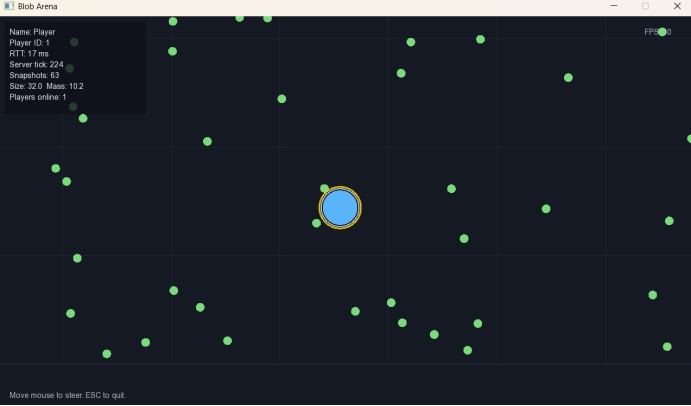

# Blob Arena

[](https://isocpp.org/)
[](https://cmake.org/)
[](https://www.sfml-dev.org/)
[](#tests)
[](#netcode)

A multiplayer Agar.io-style game in C++17 with a custom UDP netcode layer: client-side prediction, server reconciliation, and entity interpolation.

Многопользовательская игра в стиле Agar.io на C++17 с собственным UDP-netcode: client-side prediction, server reconciliation и интерполяция сущностей.

---

## 🎬 Demo


*Real-time gameplay: smooth local movement thanks to client-side prediction, remote players interpolated to hide the 20 Hz snapshot rate.*

---

## 🇬🇧 English

### About
Blob Arena is a real-time multiplayer arena game demonstrating production-grade **netcode**:

- **UDP protocol** with custom binary serialization
- **Client-side prediction** — your blob moves instantly, without waiting for the server
- **Server reconciliation** — if the server disagrees, the client rolls back and replays pending inputs
- **Entity interpolation** — remote players move smoothly even though snapshots arrive only 20 times per second
- **Authoritative server** — all game logic runs on the server; the client can't cheat

This project shows skills rarely seen in junior portfolios: understanding of UDP vs TCP tradeoffs, latency hiding, and state synchronization.

### Screenshot



*In-game view with the network debug panel: player ID, RTT, server tick, snapshots received, size, mass, players online, and FPS.*

### Features

- **UDP netcode** with binary protocol (custom `ByteWriter` / `ByteReader`)
- **Client-side prediction + reconciliation**
- **Entity interpolation** with a ring buffer of snapshots
- **RTT measurement** via Ping/Pong
- **20 Hz snapshot rate** for game state, **30 Hz input rate** for player commands
- **Dead reckoning** — smooth remote player motion
- **Player mass growth** — eat food, eat smaller players
- **Authoritative server** with 8-player cap
- **Graceful join / leave / timeout** handling
- **43 unit tests** (Google Test) covering protocol, prediction, and game logic

### Project Structure

```
blob-arena/
├── include/common/     # Shared between client and server
│   ├── Vector2.h       # 2D math
│   ├── Config.h        # All game constants
│   └── Protocol.h      # Binary packet format
├── include/server/     # Server-only
│   ├── GameState.h     # Authoritative world state
│   └── Server.h        # UDP socket + tick loop
├── include/client/     # Client-only (uses SFML)
│   ├── NetworkClient.h # Prediction + reconciliation
│   ├── Interpolator.h  # Smooth remote players
│   ├── Renderer.h      # SFML wrapper
│   └── ClientGame.h    # Main client loop
├── src/                # Implementations
├── apps/
│   ├── server_main.cpp # Server executable
│   └── client_main.cpp # Client executable
├── tests/              # 43 tests (Google Test)
└── docs/               # Demo GIF and screenshots
```

### Netcode

| Feature | Value |
|---|---|
| Protocol | UDP |
| Tick rate (server) | 20 Hz |
| Input rate (client) | 30 Hz |
| Interpolation delay | 100 ms |
| Snapshot buffer | 16 samples |
| Max players | 8 |
| Client timeout | 5 s |

The client applies inputs locally (**prediction**), then reconciles its position with the authoritative server state on every snapshot. Remote players are shown slightly in the past using **entity interpolation**, which smooths out the 20 Hz snapshot rate.

### Controls

| Key | Action |
|---|---|
| **Mouse** | Steer your blob toward the cursor |
| **ESC** | Quit |

### Getting Started

#### Prerequisites

- Visual Studio 2022 ("Desktop development with C++")
- CMake 3.20+
- vcpkg

#### Build

1. Install dependencies:

   ```bash
   vcpkg install sfml:x64-windows
   vcpkg install gtest:x64-windows
   ```

2. Clone:

   ```bash
   git clone https://github.com/Bloodmoon001/blob-arena.git
   cd blob-arena
   ```

3. Open the folder in Visual Studio (`File` → `Open` → `Folder`).
4. Select `x64-Release`, build with `Ctrl+Shift+B`.

#### Running

Open two terminals.

**Terminal 1 — server:**

```bash
./bin/Release/blob_server_app.exe
```

**Terminal 2 — client:**

```bash
./bin/Release/blob_client_app.exe
```

To test multiplayer, launch a second client in a third terminal.

**Optional arguments:**

```
blob_client_app.exe <host> <port> <name>
```

Default: `127.0.0.1 27015 Player`.

### Tests

```bash
./bin/Release/blob_tests.exe
```

Expected: `[  PASSED  ] 43 tests.`

### License

MIT License. See `LICENSE`.

---

## 🇷🇺 Русский

### О проекте

Blob Arena — многопользовательская игра в реальном времени, демонстрирующая **промышленный netcode**:

- **UDP-протокол** с собственной бинарной сериализацией
- **Client-side prediction** — твой кружок двигается мгновенно, не ждя сервера
- **Server reconciliation** — если сервер не согласен, клиент откатывает состояние и переигрывает команды
- **Entity interpolation** — чужие игроки двигаются плавно, хотя снапшоты приходят только 20 раз в секунду
- **Authoritative server** — вся игровая логика на сервере; клиент не может читерить

Этот проект показывает навыки, которые редко встречаются у джунов: понимание разницы UDP и TCP, скрытие задержек, синхронизация состояния.

### Скриншот


*Игровой вид с панелью сетевой отладки: ID игрока, RTT, тики сервера, снапшоты, размер, масса, игроков онлайн, FPS.*

### Возможности

- **UDP-netcode** с бинарным протоколом (`ByteWriter` / `ByteReader`)
- **Client-side prediction + reconciliation**
- **Интерполяция сущностей** через кольцевой буфер снапшотов
- **Измерение RTT** через Ping/Pong
- **20 Гц снапшоты** состояния игры, **30 Гц input** от игрока
- **Dead reckoning** — плавное движение чужих игроков
- **Рост массы** — ешь еду и мелких игроков
- **Authoritative server** на 8 игроков
- **Корректная обработка** входа/выхода/таймаута
- **43 unit-теста** (Google Test) для протокола, prediction и логики игры

### Структура проекта

```
blob-arena/
├── include/common/     # Общий код для клиента и сервера
├── include/server/     # Только сервер
├── include/client/     # Только клиент (использует SFML)
├── src/                # Реализация
├── apps/               # Два exe: сервер и клиент
├── tests/              # 43 теста (Google Test)
└── docs/               # Демо-GIF и скриншоты
```

### Netcode

| Параметр | Значение |
|---|---|
| Протокол | UDP |
| Tick rate сервера | 20 Гц |
| Input rate клиента | 30 Гц |
| Задержка интерполяции | 100 мс |
| Буфер снапшотов | 16 сэмплов |
| Максимум игроков | 8 |
| Таймаут клиента | 5 сек |

Клиент применяет input локально (**prediction**), потом сверяется с сервером на каждом снапшоте. Чужие игроки показываются в прошлом через **интерполяцию**, что сглаживает 20 Гц снапшоты.

### Управление

| Клавиша | Действие |
|---|---|
| **Мышь** | Движение к курсору |
| **ESC** | Выход |

### Сборка и запуск

#### Требования

- Visual Studio 2022 («Разработка классических приложений на C++»)
- CMake 3.20+
- vcpkg

#### Сборка

1. Установите зависимости:

   ```bash
   vcpkg install sfml:x64-windows
   vcpkg install gtest:x64-windows
   ```

2. Склонируйте:

   ```bash
   git clone https://github.com/Bloodmoon001/blob-arena.git
   cd blob-arena
   ```

3. Откройте папку в Visual Studio (`Файл` → `Открыть` → `Папка`).
4. Выберите `x64-Release`, соберите через `Ctrl+Shift+B`.

#### Запуск

Откройте два терминала.

**Терминал 1 — сервер:**

```bash
./bin/Release/blob_server_app.exe
```

**Терминал 2 — клиент:**

```bash
./bin/Release/blob_client_app.exe
```

Для проверки мультиплеера запустите второго клиента в третьем терминале.

**Аргументы (необязательно):**

```
blob_client_app.exe <host> <port> <name>
```

По умолчанию: `127.0.0.1 27015 Player`.

### Тесты

```bash
./bin/Release/blob_tests.exe
```

Ожидаемый вывод: `[  PASSED  ] 43 tests.`

### Лицензия

MIT License. См. файл `LICENSE`.

---